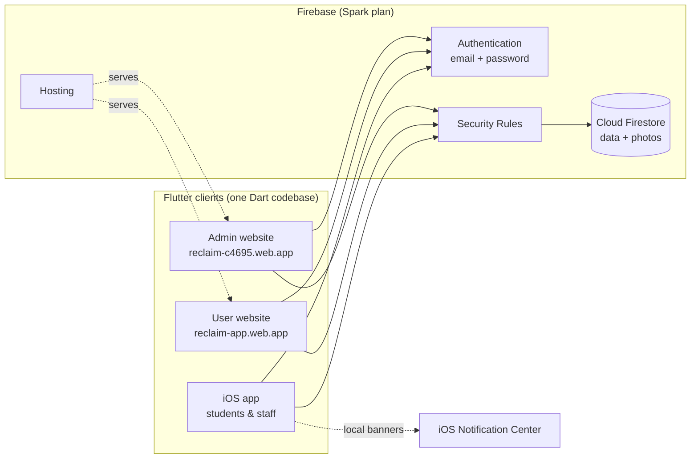
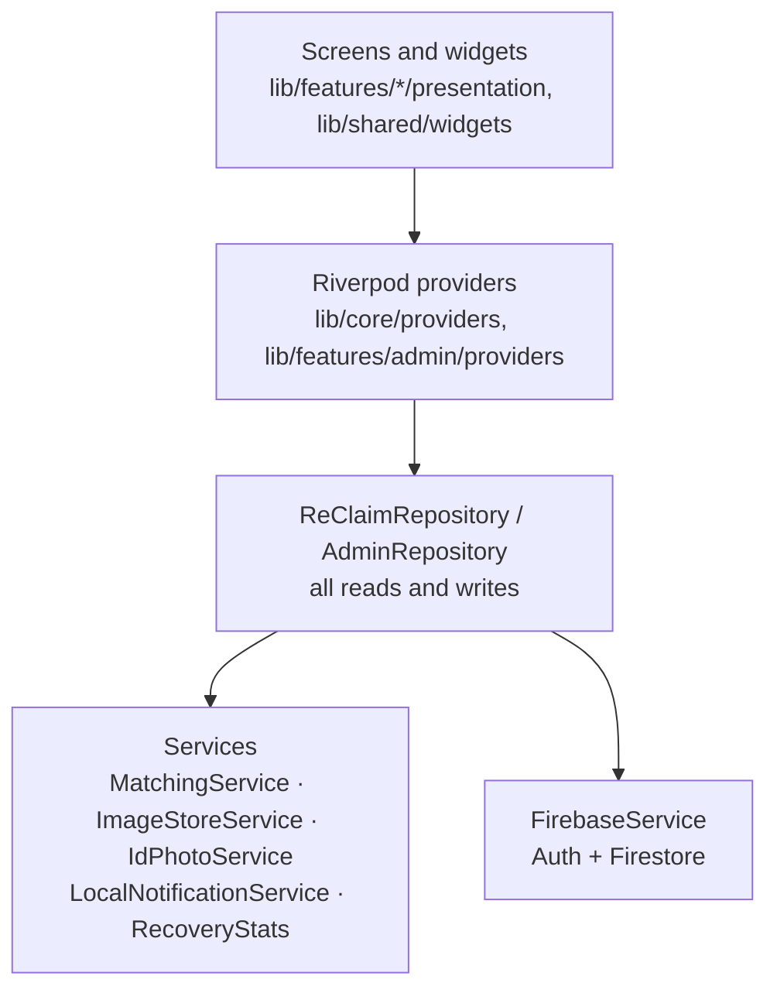
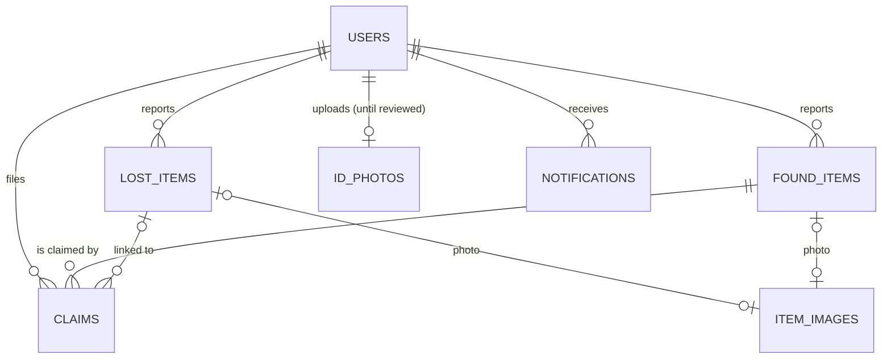
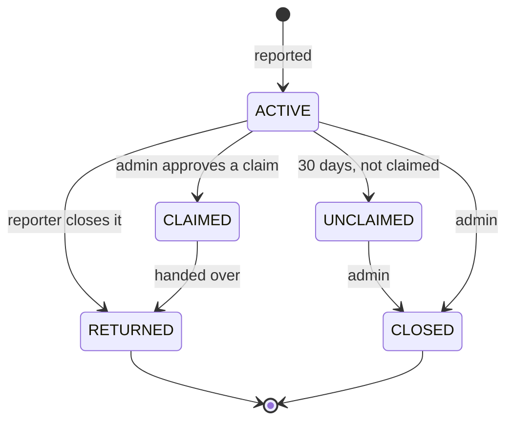
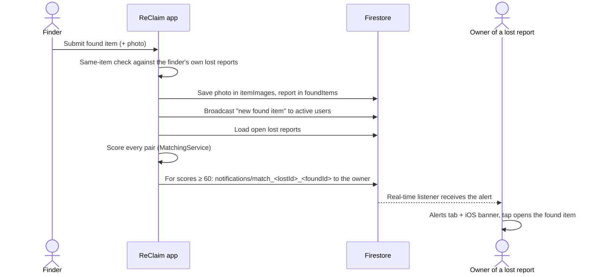

# ReClaim — System Design

This document explains how ReClaim is built and why: the architecture,
data model, main flows, matching algorithm, security model, UI design
system, and the trade-offs behind them. For setup and run instructions,
see [README.md](README.md).

## 1. Purpose and scope

ReClaim is a lost-and-found system for the PSG Tech campus. Students and
staff report lost and found items, the system suggests likely matches,
and items are returned only after an administrator checks the claimant's
ownership.

| In scope | Out of scope (see §13) |
|---|---|
| Reporting lost and found items with photos | In-app chat between owner and finder |
| Automatic matching and match alerts | Dispute resolution workflow |
| Ownership claims decided by admins | Image analysis in matching |
| College ID verification | Remote push notifications |
| Admin moderation and recovery analytics | Android app |

## 2. Constraints

These constraints shaped most design decisions:

- **Free Firebase Spark plan.** No Cloud Functions, no Firebase Storage,
  no paid services. All logic runs in the clients; all data, including
  photos, lives in Cloud Firestore.
- **No paid Apple Developer account.** No App Store, TestFlight or
  remote push (APNs). The iOS app is installed with free Apple ID signing.
- **PSG Tech members only.** Accounts require an `@psgtech.ac.in` email
  and a college ID photo.
- **One small team, one codebase.** A single Flutter project produces
  every client.

## 3. Architecture

### 3.1 Clients

One Flutter (Dart) codebase builds three clients. All of them talk
directly to the same Firebase project; there is no custom server.

| Client | Users | Platform | Build |
|---|---|---|---|
| ReClaim (iOS) | Students and staff | iPhone | `flutter build ios` |
| ReClaim (web) | Students and staff | Any browser, <https://reclaim-app.web.app> | `tool/build_web.sh app` (`--dart-define=APP=user`) |
| ReClaim Admin | Administrators | Browser, <https://reclaim-c4695.web.app> | `tool/build_web.sh admin` |

Each build serves only its own screens. The router
(`lib/core/routes/app_router.dart`) redirects any admin route away in
user builds, and any user route to the admin login in the admin build.
On the web, Flutter compiles Dart to JavaScript (`main.dart.js`).

### 3.2 Layers inside the app

- **Screens** only display state and call provider methods.
- **Providers** (Riverpod) hold the signed-in user, reports, claims,
  alerts and admin data, and rebuild screens when data changes.
- **Repositories** are the only code that touches Firestore. Methods
  that users call on their own data let errors reach the screen, so a
  write refused by the security rules is never shown as a success.
- **Services** are pure logic (matching, statistics) or thin wrappers
  around one Firebase collection or plugin.

### 3.3 Technology

| Concern | Choice |
|---|---|
| UI framework | Flutter 3.44, Dart 3.12, Material 3 |
| State | flutter_riverpod 2.6 |
| Navigation | go_router 14.8 |
| Auth | firebase_auth 5.7 (email and password) |
| Database | cloud_firestore 5.6 |
| Photos | image_picker 1.2, stored as bytes in Firestore |
| Banners | flutter_local_notifications 22.3 (iOS) |
| Typeface | google_fonts (Plus Jakarta Sans) |
| Hosting | Firebase Hosting, two sites |

## 4. Data model

All data is in Cloud Firestore.

| Collection | Holds | Key fields |
|---|---|---|
| `users` | Profile | name, email, phone, department, rollNumber, role, isActive, verificationStatus |
| `active_users` | Who receives broadcasts | uid |
| `lostItems` | Lost reports | ownerId, itemName, category, description, brand, colour, dateLost, locationLost, approximateValue, imageUrl, status |
| `foundItems` | Found reports | finderId, same item fields, dateFound, locationFound, currentHolder, securityOfficeSubmitted, status |
| `itemImages` | Item photos as bytes (≤ 900 KB) | bytes, uploaderId |
| `idPhotos` | College ID photo awaiting review, one per user | bytes; deleted after review |
| `claims` | Ownership claims | foundItemId, lostItemId, claimantId, answers, status |
| `notifications` | Alerts | userId, type, title, body, targetId, isRead |
| `activityLogs` | Admin actions | actorId, actorName, action, targetType, targetId, details, timestamp |

A report's `imageUrl` holds a reference such as
`firestore:itemImages/<id>`; older reports may hold a web link instead.

### 4.1 Report lifecycle

`MATCHED` exists for older data and is treated like `ACTIVE`. Only
`ACTIVE`, `MATCHED` and `UNCLAIMED` reports count as open.

## 5. Main flows

### 5.1 Reporting and matching

The same steps run in the other direction when a lost item is reported,
and again when a report is edited. The finder is never told about a
match; only the lost report's owner is.

### 5.2 Claiming an item

1. The owner opens a found item (from a match or search) and submits
   **Claim This Found Item** with answers about unique marks and contents.
2. A `claims` document is created with status `PENDING`; admins are notified.
3. An admin compares the answers with the report on the **Claims** page
   and sees whether the claimant's college ID is verified.
4. **Approve** marks the claim and the linked lost and found reports
   `CLAIMED` in one batched write; **Reject** marks only the claim.
5. The claimant gets an alert saying where to collect the item, and the
   decision is written to `activityLogs`.

### 5.3 College ID verification

1. At sign-up the user must attach a photo of their college ID. It is
   stored in `idPhotos/{uid}` and the user's status becomes `PENDING`.
2. An admin compares the photo with the name and roll number on the
   **Verification** page and verifies or rejects it with a reason.
3. In the same batch, the user's status is updated and the photo is
   **deleted**, so no ID images are kept. Rejected users can upload again.

Government IDs (Aadhaar, PAN) are deliberately not collected.

## 6. Matching algorithm

`lib/core/services/matching_service.dart` scores each lost/found pair
out of 100. It is pure Dart and runs on the device.

| Attribute | Weight | How it is scored |
|---|---|---|
| Category | 25 | Same category |
| Name and description | 25 | Word overlap (Jaccard similarity), plus a bonus when one name contains the other |
| Brand | 15 | Same or contained brand; unknown brands score little |
| Location | 15 | Same or overlapping place names |
| Colour | 10 | Same colour |
| Date | 10 | Full within 1 day, falling to 10% after 14 days |

| Threshold | Score | Used for |
|---|---|---|
| `displayThreshold` | 35 | Listed under Possible matches |
| `notifyThreshold` | 60 | Alert sent to the lost report's owner |
| `sameItemThreshold` | 70 | A user's own lost and found reports are treated as the same item, and the second report is refused |

Rules:

- A user's own lost and found reports are never matched with each other.
- Only open reports are matched.
- Each pair is alerted at most once: the alert has a fixed document ID
  (`match_<lostId>_<foundId>`), and the rules refuse to overwrite it.
- Users see only the overall percentage, not the per-attribute scores.

## 7. Notifications

There is no push server. Alerts are Firestore documents delivered by
real-time listeners.

| Type | Sent to | When |
|---|---|---|
| `COMMON` | All other active users | A lost or found item is reported |
| `POTENTIAL_MATCH` | Owner of the lost report | Score ≥ 60 |
| `CLAIM_SUBMITTED` | Admins | A claim is filed |
| `CLAIM_APPROVED` / `CLAIM_REJECTED` | Claimant | An admin decides |
| `VERIFICATION_APPROVED` / `VERIFICATION_REJECTED` | The user | An admin reviews the ID |

- The app listens to `notifications` where `userId` is the signed-in
  user (`snapshots()` → Riverpod `StreamProvider`).
- On iOS, new match, claim and verification alerts also raise a local
  banner through `flutter_local_notifications`. Tapping it opens the item.
- In browsers there are no banners; the Alerts tab still updates live.
- Broadcasts are written in batches of up to 400 documents.

## 8. Photos

Firebase Storage is not available on the Spark plan, so photos are
stored in Firestore:

- The phone resizes each photo to at most 1024 px at 70% JPEG quality
  (about 100 KB).
- The bytes go into `itemImages` as a Firestore `Blob`; the rules refuse
  anything over 900 KB (Firestore's document limit is 1 MiB).
- Loaded photos are cached in memory. Replacing or deleting a report
  deletes its photo.
- Found-item photos help owners recognise their items; ID photos are
  kept only until an admin has reviewed them.

## 9. Security

Access control is enforced on the server by `firestore.rules`, not only
in the app. The rules are covered by 40 emulator tests in
`firestore-tests/`.

| Data | Rule |
|---|---|
| `users` | Users read and edit only their own profile and cannot change their role, active flag or verification result. Admin accounts are created in the Firebase console only. |
| Reports | Any signed-in user can read. Only the reporter (or an admin) can edit or delete, and the owner field cannot be changed. |
| `claims` | Claimant and admins read; only admins decide. |
| `notifications` | A user may notify only themselves, broadcast about their own report, tell admins about their own claim, or tell a lost report's real owner about a match (checked with `get()`). Recipients may only mark alerts read. |
| `idPhotos` | Only the user and admins; at most 900 KB. Users move their own status only between none/rejected → pending → none. |
| `activityLogs` | Admins only. |

Checks that need similarity scoring (the same-item check, matching)
run in the app, because security rules cannot compare reports.
Firebase config files and signing keys are kept out of git.

## 10. UI design system

A soft, friendly look shared by the iOS app and both websites.

| Token | Value | Use |
|---|---|---|
| Primary | `#5B5BD6` indigo; gradient `#6366F1 → #8B5CF6` | Brand, main buttons |
| Lost | `#FF7A59` coral; gradient `#FF9A76 → #FF6B6B` | Everything about lost items |
| Found | `#14B8A6` teal; gradient `#2DD4BF → #0EA5A4` | Everything about found items |
| Match | `#F59E0B` amber | Match cards and scores |
| Background | `#F6F5FB` lavender-white | Screens |
| Text | `#1E1B3A` / `#5C5A75` / `#9B99B3` | Primary / secondary / muted |
| Feedback | success `#10B981`, error `#EF4444` | Messages |
| Typeface | Plus Jakarta Sans | All text |
| Radius | 10 / 16 / 20 / 28 px | Chips / inputs / cards / sheets |
| Spacing | 4 / 8 / 16 / 24 / 32 / 48 px | Layout |

- **Components** (`lib/shared/widgets/`): gradient buttons, soft-shadow
  cards that shrink slightly with a light haptic tap when pressed,
  photo-first item cards, status pills, category icons and form fields.
- **Status pills** have their own colours: Active indigo, Matched amber,
  Claimed violet, Unclaimed orange, Returned teal, Closed grey.
- **Navigation** on iOS is a floating tab bar whose centre **+** opens
  "I lost something" / "I found something". The admin site uses a sidebar.
- **Motion**: lists fade and slide in; match scores and charts animate.
- Tokens live in `lib/core/constants/app_colors.dart`,
  `lib/core/constants/app_styles.dart` and `lib/core/theme/app_theme.dart`.

## 11. Testing

| Suite | Count | Covers |
|---|---|---|
| Unit and widget tests (`flutter test`) | 70 | Matching, match alerts, same-item check, owner actions, claims, ID verification, recovery statistics, photos, admin pages |
| Security-rule tests (`firestore-tests/`) | 40 | Every rule in §9, against the Firestore emulator |
| Screenshot tour (`tool/screen_tour.py`) | 16 screens | Walks the iOS app on a simulator with seeded emulator data |
| Static analysis (`flutter analyze`) | — | flutter_lints |

## 12. Deployment

| Target | How |
|---|---|
| iOS app | `flutter build ios --release`, then `flutter install` to a phone signed with a free Apple ID; reinstall every 7 days |
| User website | `tool/build_web.sh app` → `firebase deploy --only hosting:app` |
| Admin website | `tool/build_web.sh admin` → `firebase deploy --only hosting:admin` |
| Security rules | `firebase deploy --only firestore:rules` after the emulator tests pass |

Web builds read their Firebase settings from `firebase_web.json` at
build time (not in git). Changes go through a feature branch and a pull
request into `main`.

## 13. Design decisions and trade-offs

| Decision | Why | Cost |
|---|---|---|
| No server; logic in the clients | Spark plan has no Cloud Functions | Matching uses the reports the device has loaded; notifications are written by clients and constrained by rules |
| Photos in Firestore | No Firebase Storage on Spark | 900 KB limit per photo; photos must be compressed |
| Local banners instead of push | APNs and FCM need paid accounts or a server | No banners while the app has been closed for a long time |
| iOS app plus web, not Android | Team decision; web gives anyone access for free | Android users use the website |
| User app also on the web | App Store needs a paid account | No banners or camera-first flow in browsers |
| Admin only on the web | Admins work at a desk; keeps admin code out of the phone app | Admin accounts are set up in the Firebase console |
| Admins decide every claim | Simple, trustworthy ownership check | Returns wait for an admin |
| ID photos deleted after review | Privacy; nothing sensitive is kept | Re-verification needs a new upload |
| 30-day UNCLAIMED status computed on load | No scheduled jobs on Spark | Saved only when the owner or an admin opens the app |

## 14. Future work

- **In-app chat** between owner and finder (Firestore `chats/{id}/messages`;
  security rules for it already exist).
- **Hidden detail** recorded by the finder for ownership checks.
- **Dispute resolution** for contested claims, with an admin page.
- **Image analysis** to compare item photos during matching.
- **Remote push notifications** if a paid plan becomes available.
- **Clearer offline handling** on the web: show a "can't connect"
  message instead of falling back to built-in sample data.
